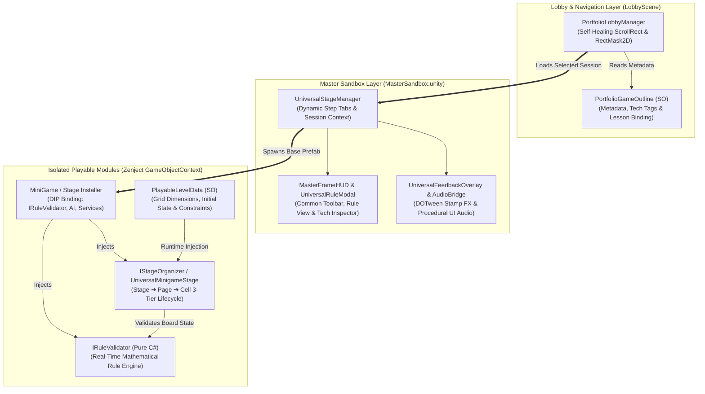

# Interactive Logic & Board Game Master Framework (Unity Portfolio)

A modular, data-driven interactive puzzle and board game framework built in **Unity (C#)**.  
Distilled from nearly 6 years of live-service experience across 200+ mathematical logic puzzles and board games, this repository demonstrates **standardized 3-tier UI/Stage lifecycle management**, **Zenject SubContainer (`GameObjectContext`) isolation**, **reactive state binding via UniRx**, and **procedural UGUI layout orchestration** within a unified single-scene sandbox.

---

## 🏗️ Framework Architecture & Execution Flow



---

## 🌟 Key Engineering Highlights (UGUI & System Architecture)

### 1. Standardized 3-Tier Lifecycle (`Stage ➔ Page ➔ Component`)
- Unifies heterogeneous interactive contents under a strict lifecycle contract (`Initialize ➔ Activate Interaction ➔ Validate Rule ➔ Complete / Reset`).
- **`UniversalStageManager`** dynamically generates stage navigation tabs from `LessonOutline` ScriptableObjects and manages intermediate state serialization (`IStateRestorable`) across stage transitions.

### 2. UGUI Dynamic Layout Synchronization & Self-Healing Views
- **Immediate Layout Rebuilding**: Resolves UGUI `GridLayoutGroup` frame-delay misalignment when spawning procedural grid cells and hint overlays at runtime via `LayoutRebuilder.ForceRebuildLayoutImmediate` and post-late-update coordinate tracking.
- **Viewport Masking & Input System Integration**: Implements dynamic `ScrollRect` + `RectMask2D` wrapping in `PortfolioLobbyManager` with smooth mouse-wheel horizontal scrolling (`Mouse.current.scroll`) and hold-to-repeat UI buttons (`RepeatButton`) powered by the Unity New Input System.
- **Runtime Font Fallback**: Automatically guards against missing legacy font references in dynamically loaded prefabs without mutating original asset GUIDs.

### 3. Reactive UI Lifecycle & Memory Leak Prevention (`UniRx`)
- **Top-Level UI Panels (`UIRootBase`)**: Manages `Show` / `Hide` transitions by explicitly killing active DOTween sequences and clearing `CompositeDisposable` streams upon deactivation to prevent zombie event callbacks.
- **Granular UI Components**: Binds cell state mutations (e.g., cross-axis illumination, toggle states) via `ReactiveProperty<T>` and `.AddTo(this)` for deterministic disposal without `Update()` polling.

### 4. Zenject SubContainer (`GameObjectContext`) Module Isolation
- Each playable game root prefab encapsulates its own `GameObjectContext` and dedicated `MonoInstaller` (e.g., `Month10HighInstaller`, `GonuInstaller`, `UniversalMinigameInstaller`).
- Adheres to the **Open-Closed Principle (OCP)**: adding new puzzle modules requires zero modifications to the global `ProjectContext` or `MasterSandbox` scene.
- Decouples external platform dependencies (`ISoundService`, `IPopupService`, `IAPIService`) via Dependency Inversion (DIP) and mock service injection for standalone execution.

### 5. Real-Time Mathematical Rule Validation Engines (`IRuleValidator`)
Rather than relying on hardcoded answer keys, each module evaluates board states algorithmically so that any logically valid player solution is accepted:

| Module | Genre / Rule | Core Algorithmic & UI Implementation |
| :--- | :--- | :--- |
| **Month 10 High** | Shikaku (Grid Partitioning) | Pure C# `RectSquareRuleValidator`; procedural grid spawning from SO; real-time drag-frame anchor scaling and aspect-ratio (horizontal/vertical/square) validation. |
| **Why02 Week 11** | Gonu (Traditional Board Game) | Bidirectional adjacency graph validation (`GonuRuleValidator`), deadlock detection, and heuristic AI opponent (`GonuAIService`) across 4 rule stages. |
| **Month 35 High** | Seesaw Torque Logic Puzzle | Lever fulcrum distance $\times$ weight moment equilibrium formula (`PlaySeesawFrame`) combined with row/column sum constraint verification. |
| **Month 34 High** | Number Island (Nurikabe Variant) | Recursive `FloodFillLand()` BFS clustering, bounding-box rectangular area verification, and $2 \times 2$ ocean pool prevention (`NumberIslandRuleValidator`). |
| **Month 22 Low** | Lighthouse Surveillance | `UniRx` `ReactiveProperty` cross-axis (row/column) illumination tracking and composite local + global lighthouse count verification. |

### 6. Custom Editor Automation Toolchain (`PortfolioBuilderHelper`)
- Provides one-click asset assembly via **`MasterFramework > Build All Portfolio Assets`**.
- Automatically constructs playable cell/stage prefabs, maps sprite GUIDs, binds `PlayableLevelData` ScriptableObjects, and registers `PortfolioGameOutline` entries into the Lobby scene.

---

## 🎮 Quick Start & Running the Showcase

1. **Environment Requirements**:
   - **Unity Editor**: `2021.3 LTS` or `Unity 6 (6000.x)`
   - **Platform**: PC Standalone / WebGL / Mobile (iOS & Android compatible UGUI)

2. **Running from the Lobby Hub**:
   - Open `Assets/Scenes/LobbyScene.unity` and press **Play**.
   - Scroll horizontally (drag or mouse wheel) through the game cards to inspect each game's core mechanism and engineering tags.
   - Click any card to launch the module inside `MasterSandbox.unity`.
   - Use the top **Master Frame HUD** to switch between stages (`Stage 1` ~ `Stage 4`), view rules (`Rule`), reset the board (`Refresh`), or return to the lobby (`Lobby`).

---

## 📂 Repository Structure

```
Assets/
├── Editor/
│   └── PortfolioBuilderHelper.cs         # One-click prefab, SO & lobby scene builder
├── MasterFramework/
│   ├── API/                              # IAPIService, MockAPIService, RealAPIService
│   ├── Core/                             # Lifecycle interfaces, IRuleValidator, HistoryManager (Undo/Redo), AudioBridge
│   ├── DependencyInjection/              # Zenject FrameworkSceneInstaller
│   ├── Interaction/                      # DragDropSystem, IGridSystem, IInteractable
│   ├── Navigation/                       # PortfolioLobbyManager, UniversalStageManager, MasterFrameHUD, RuleModal
│   ├── Playable/                         # Isolated playable game modules (.asmdef & SubContainers)
│   │   ├── Common/                       # UniversalMinigameStage & Installer
│   │   ├── Month10High/                  # Rectangular/Square Grid Partitioning Puzzle
│   │   ├── Month22Low/                   # Lighthouse Cross-Axis Logic Puzzle
│   │   ├── Month34High/                  # Number Island BFS Clustering Puzzle
│   │   ├── Month35High/                  # Seesaw Torque Balance Puzzle
│   │   └── Why02_Gonu/                   # Adjacency Graph Board Game & AI
│   ├── Services/                         # Mock Sound/Popup/FeedbackStamp & Save services
│   └── Tutorial/                         # Data-driven TutorialEngine & ILockableElement
└── Scenes/
    ├── LobbyScene.unity                  # Main arcade hub & game selector
    └── MasterSandbox.unity               # Unified runtime sandbox scene
```

---

## 🔧 Technical Troubleshooting Highlights

| Category | Issue Encountered | Root Cause | Engineering Resolution |
| :--- | :--- | :--- | :--- |
| **UGUI Layout Timing** | Pre-spawned hint frames collapsed to `(0, 0)` upon stage load | `GridLayoutGroup` calculates cell positions at the end of the frame, so immediate coordinate queries returned uninitialized positions. | Triggered `LayoutRebuilder.ForceRebuildLayoutImmediate` right after cell instantiation and synchronized frame anchoring via post-late-update tracking. |
| **Dynamic Viewport Masking** | ScrollView cards overflowed or turned invisible when masked | Legacy `Mask` component required a valid source image sprite and caused stencil buffer overhead. | Replaced with `RectMask2D` via self-healing runtime setup (`EnsureScrollViewSetup`), eliminating sprite dependencies and draw-call overhead. |
| **Natural Numeric Ordering** | Grid cells `(10)` sorted before `(2)` during hierarchy traversal | `GetComponentsInChildren` returns transforms in alphabetical order when named sequentially. | Enforced regex-based integer parsing (`OrderBy(ExtractButtonIndex)`) during board initialization to guarantee 1:1 data-to-cell index integrity. |
| **Input System Migration** | `InvalidOperationException` on legacy `Input` calls in hold buttons | Project active input handling switched to Unity New Input System. | Refactored `RepeatButton` and drag handlers to use `UnityEngine.InputSystem` (`Pointer.current`, `Keyboard.current`) with `IPointerDownHandler`. |
